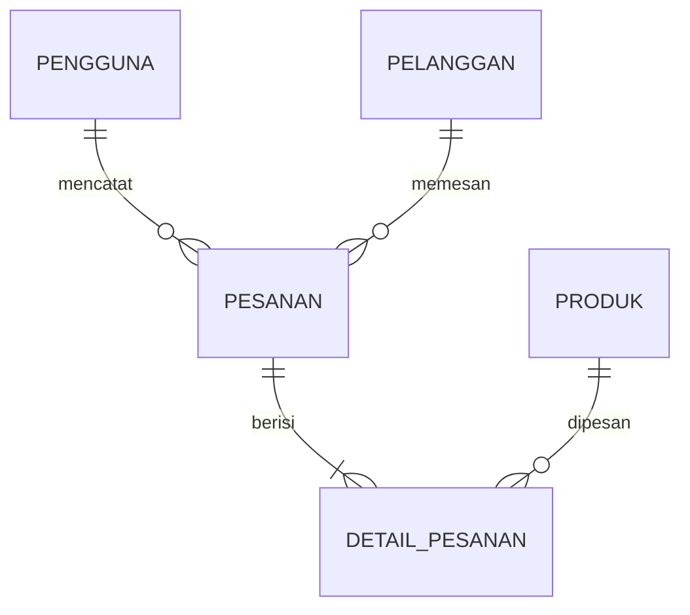

# 🥟 Yummy Risol Manager

Aplikasi desktop manajemen penjualan untuk **Yummy Risol**, UMKM risol di daerah Jatinangor. Dibuat sebagai tugas besar mata kuliah **Pemrograman Berorientasi Objek (PBO)**.

Aplikasi ini menggantikan pencatatan manual (pesanan, stok, data pelanggan, rekap penjualan) dengan sistem yang tersimpan di database MySQL.

| Aspek | Keterangan |
|---|---|
| Mata kuliah | Pemrograman Berorientasi Objek (PBO) |
| Tema | Bisnis UMKM di daerah Jatinangor |
| Bahasa & GUI | Java, Swing (tampilan dibuat lewat kode, tanpa GUI Builder NetBeans) |
| Tampilan | [FlatLaf](https://www.formdev.com/flatlaf/) 3.5.4 dengan tema oranye dan font Plus Jakarta Sans |
| Database | MySQL (JDBC, `mysql-connector-j` 8.4.0) |
| Build | Maven |

---

## ✨ Fitur

| Modul | Fitur | Admin | Kasir |
|---|---|:-:|:-:|
| Login | Masuk dengan username, password, dan pilihan peran | ✔ | ✔ |
| Dashboard | Jumlah pesanan hari ini, total penjualan, jumlah produk stok hampir habis, banner peringatan stok, dan daftar pesanan terbaru | ✔ | ✔ |
| Kelola Produk | Tambah, ubah, hapus, dan cari produk (nama atau rasa); atur harga, stok, dan stok minimum | ✔ | ✘ |
| Kelola Pelanggan | Tambah, ubah, hapus, dan cari data pelanggan | ✔ | ✔ |
| Buat Pesanan | Pilih pelanggan, produk, dan jumlah; total dihitung otomatis; pilih metode order (Langsung, WhatsApp, Titip) | ✔ | ✔ |
| Laporan Penjualan | Riwayat pesanan, filter per tanggal, rekap jumlah pesanan dan total penjualan, ubah status pesanan (Baru, Diproses, Selesai) | ✔ | ✘ |

Catatan perilaku:
- Menu **Produk** dan **Laporan** di sidebar dinonaktifkan untuk Kasir.
- Pesanan disimpan dalam **satu transaksi database**: pesanan, detail, dan pengurangan stok berhasil bersama atau dibatalkan bersama (rollback), misalnya saat stok tidak cukup.
- **Total penjualan** hanya menghitung pesanan berstatus `SELESAI`.
- Tombol **Batal** pada Buat Pesanan meminta konfirmasi bila form sudah berisi item.

---

## 🧱 Penerapan PBO

### Hierarki Produk (Inheritance + Polymorphism)

```
Produk (abstrak)
 ├── RisolManis (abstrak)       getJenis() = "MANIS"
 │     ├── RisolCoklat          diskon 5% untuk 10 pcs ke atas
 │     ├── RisolMatcha          beli 5 gratis 1
 │     └── PaketManis           harga paket dari database
 └── RisolAsin (abstrak)        getJenis() = "ASIN"
       ├── RisolMayo            harga normal
       ├── RisolRagout          diskon 10% untuk 20 pcs ke atas
       └── PaketAsin            harga paket dari database
```

Setiap rasa meng-override `hitungHarga(int jumlah)` dengan aturannya sendiri, lalu dipanggil lewat tipe induk:

```java
Produk p = new RisolMatcha(...);
double total = p.hitungHarga(6); // 5 dibayar, 1 gratis
```

Aturan promo pada kode saat ini adalah contoh dan bisa disesuaikan dengan kebijakan pemilik.

### Kelas lain

| Kelas | Peran | Konsep PBO |
|---|---|---|
| `Person` (abstrak) | `nama`, `noHp` | Inheritance, encapsulation |
| `Pelanggan` | Turunan `Person`, ditambah `alamat` | Inheritance |
| `Produk` | Atribut `private` dengan getter/setter dan validasi (harga dan stok tidak boleh negatif) | Encapsulation |
| `ProdukFactory` | Membuat objek turunan `Produk` yang tepat dari baris tabel (berdasarkan kolom `rasa` dan `jenis`) | Factory |
| `Pesanan`, `DetailPesanan` | Pesanan memiliki daftar item dan menghitung total | Composition |
| `FrameDasar` (abstrak) | Kerangka layar (sidebar + area isi) yang diwarisi `ProdukFrame`, `PelangganFrame`, `PesananFrame`, `LaporanFrame` | Inheritance, reuse |
| `Menu` | Mengatur tema global dan perpindahan antar layar | Pemisahan tanggung jawab |
| `db/*Repository` | Seluruh query SQL dipisah dari UI | Pemisahan lapisan |
| `Koneksi` | Membuka koneksi JDBC | Abstraksi akses data |

---

## 📁 Struktur Proyek

```
.
├── README.md
├── yummy_risol.sql                       # database + data contoh
└── YummyRisolManager/
    ├── pom.xml
    └── src/main/
        ├── java/com/mycompany/yummyrisolmanager/
        │   ├── YummyRisolManager.java    # main(), hanya memanggil Menu
        │   ├── Menu.java                 # tema global + perpindahan layar
        │   ├── model/                    # Produk & turunannya, Person, Pelanggan, Pesanan, DetailPesanan
        │   ├── db/                       # Koneksi + repository per tabel
        │   └── ui/                       # LoginFrame, DashboardFrame, Produk/Pelanggan/Pesanan/LaporanFrame,
        │                                 # PanelSidebar, Komponen, Tema, dan komponen kustom
        └── resources/fonts/              # Plus Jakarta Sans dan Poppins
```

---

## 🗄️ Database

Nama database: **`yummy_risol`** (skrip lengkap ada di `yummy_risol.sql`).

| Tabel | Kolom | Keterangan |
|---|---|---|
| `pengguna` | `id_pengguna` (PK), `nama`, `username`, `password`, `jabatan` | Akun login; `jabatan` bernilai `ADMIN` atau `KASIR` |
| `produk` | `id_produk` (PK), `nama_produk`, `jenis`, `rasa`, `tipe`, `isi`, `harga`, `stok`, `stok_minimum` | Daftar risol dan paket |
| `pelanggan` | `id_pelanggan` (PK), `nama`, `no_hp`, `alamat` | Data pembeli |
| `pesanan` | `id_pesanan` (PK), `id_pelanggan` (FK), `id_pengguna` (FK), `tanggal`, `metode_order`, `status`, `total_bayar` | Satu baris per transaksi |
| `detail_pesanan` | `id_detail` (PK), `id_pesanan` (FK), `id_produk` (FK), `jumlah`, `subtotal` | Item di dalam pesanan |

Nilai kolom enum:
- `produk.jenis`: `MANIS`, `ASIN`
- `produk.tipe`: `SATUAN`, `PAKET`
- `pesanan.metode_order`: `LANGSUNG`, `WHATSAPP`, `TITIP`
- `pesanan.status`: `BARU`, `DIPROSES`, `SELESAI`



Hierarki produk di Java disimpan di database hanya lewat kolom `jenis` dan `rasa`; tidak ada tabel per kelas turunan.

---

## 🚀 Cara Menjalankan

### Prasyarat
- **JDK 26** (sesuai `maven.compiler.release` di `pom.xml`). Jika memakai JDK lebih lama, turunkan nilai tersebut di `pom.xml`.
- Maven (atau NetBeans, yang sudah menyertakan Maven)
- MySQL / MariaDB aktif di `localhost:3306` (misalnya lewat XAMPP atau Laragon)

### Langkah

1. **Clone repositori**
   ```bash
   git clone https://github.com/d0nqiote/Project-PBO.git
   cd Project-PBO/YummyRisolManager
   ```

2. **Import database.** File `yummy_risol.sql` sudah berisi pembuatan database, semua tabel, dan data contoh (produk, pelanggan, pesanan, dan akun login). Di HeidiSQL pilih *File → Run SQL file*, atau lewat terminal:
   ```bash
   mysql -u root -p < ../yummy_risol.sql
   ```

   Akun login bawaan:

   | Peran | Username | Password |
   |---|---|---|
   | Admin | `admin` | `admin123` |
   | Kasir | `kasir` | `kasir123` |

3. **Sesuaikan koneksi** di `src/main/java/com/mycompany/yummyrisolmanager/db/Koneksi.java` bila perlu:
   ```java
   private static final String URL = "jdbc:mysql://localhost:3306/yummy_risol";
   private static final String USER = "root";
   private static final String PASSWORD = "";
   ```

4. **Jalankan aplikasi**
   ```bash
   mvn compile exec:java -Dexec.mainClass=com.mycompany.yummyrisolmanager.YummyRisolManager
   ```
   Atau buka folder `YummyRisolManager` di NetBeans lalu jalankan (Run Project).

5. **Login** dengan username, password, dan peran (`Admin` atau `Kasir`) yang sesuai dengan data di tabel `pengguna`.

---

## ⚠️ Catatan

- Password di tabel `pengguna` saat ini dicek sebagai teks biasa. Untuk pemakaian nyata, simpan dalam bentuk hash (misalnya BCrypt).
- Kredensial database ditulis langsung di `Koneksi.java`. Jangan commit password asli.
- Seluruh query memakai `PreparedStatement` sehingga aman dari SQL injection.

---

## 👥 Anggota Kelompok

| Nama | NPM |
|---|---|
| Kaila | 140810250007 |
| Farah | 140810250049 |
| Naura | 140810250088 |