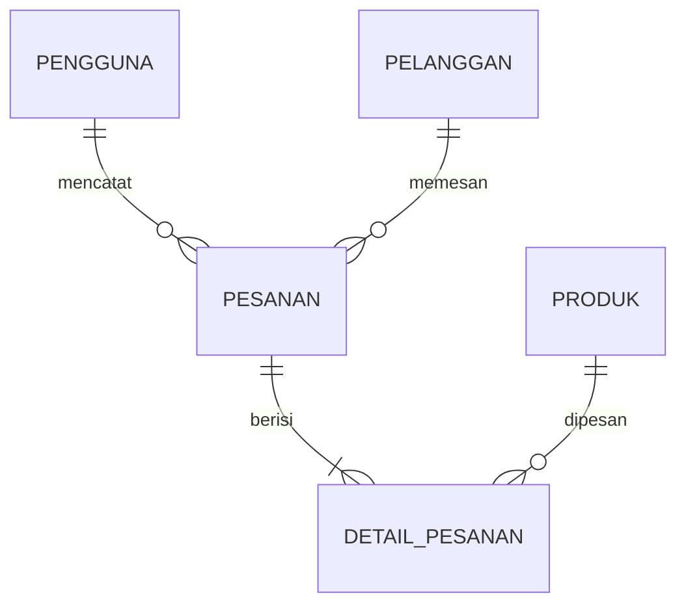

# Yummy Risol Manager

Aplikasi desktop manajemen penjualan untuk **Yummy Risol**, UMKM risol di daerah Jatinangor. Dibuat sebagai tugas besar mata kuliah **Pemrograman Berorientasi Objek (PBO)**.

| Aspek | Keterangan |
|---|---|
| Mata kuliah | Pemrograman Berorientasi Objek (PBO) |
| Tema | Bisnis UMKM di daerah Jatinangor |
| UMKM | Yummy Risol |
| Bahasa & GUI | Java, Swing |
| IDE | NetBeans |
| Database | MySQL |

---

## 1. Latar Belakang

UMKM kuliner kecil umumnya masih mencatat pesanan dan penjualan secara manual, sehingga rawan salah hitung dan sulit direkap. Dugaan awal masalah di Yummy Risol (akan dikonfirmasi saat wawancara pemilik):

- Pesanan dari banyak pelanggan sulit dilacak statusnya (baru, diproses, selesai).
- Stok risol dan bahan tidak tercatat rapi, sehingga bisa habis tanpa terpantau.
- Rekap penjualan harian atau mingguan memakan waktu karena dihitung manual.
- Data pelanggan langganan tidak tersimpan, padahal berguna untuk pesanan berulang.

## 2. Tujuan

Mengganti pencatatan manual dengan sistem yang tersimpan di database dan mudah dipakai pemilik:

- Mencatat pesanan dan transaksi dengan total harga otomatis.
- Memantau stok produk dan menandai produk yang hampir habis.
- Menyajikan rekap penjualan per hari tanpa hitung manual.
- Menyimpan data pelanggan untuk pesanan berulang.
- Menerapkan konsep PBO (class, inheritance, encapsulation, polymorphism) pada kasus usaha nyata.

## 3. Fitur Utama

| Modul | Fitur | Pengguna |
|---|---|---|
| Login | Masuk dengan username dan password | Admin, Kasir |
| Produk | Tambah, ubah, hapus, cari produk; atur harga dan stok | Admin |
| Pelanggan | Simpan dan cari data pelanggan | Admin, Kasir |
| Pesanan | Buat pesanan, pilih produk dan jumlah, hitung total otomatis, ubah status | Admin, Kasir |
| Laporan | Riwayat pesanan dan rekap penjualan per tanggal | Admin |

Tambahan: peringatan stok hampir habis dan ringkasan penjualan hari ini di Dashboard.

## 4. Gambaran Antarmuka (6 Layar)

| Layar | Komponen Swing utama | Isi |
|---|---|---|
| Login | JFrame, JTextField, JPasswordField, JButton | Form masuk |
| Dashboard | JFrame, JMenuBar, JButton | Navigasi ke semua modul dan ringkasan penjualan hari ini |
| Kelola Produk | JTable, JTextField, JButton | Tabel produk dan form tambah, ubah, hapus |
| Kelola Pelanggan | JTable, JTextField, JButton | Tabel pelanggan dan form data |
| Buat Pesanan | JComboBox, JSpinner, JTable, JLabel | Pilih pelanggan dan produk, daftar item, total bayar |
| Laporan Penjualan | JTable, JComboBox | Riwayat pesanan dan rekap per tanggal |

## 5. Rancangan Kelas dan Penerapan PBO

`Main` hanya memanggil `Menu`, dan setiap method mengerjakan satu tugas.

### Hierarki Produk (Inheritance + Polymorphism)

```
Produk (abstrak)
 ├── RisolManis (abstrak)
 │     ├── RisolCoklat
 │     └── RisolMatcha
 └── RisolAsin (abstrak)
       ├── RisolMayo
       └── RisolRagout
```

Method `hitungHarga(int jumlah)` di-override pada tiap turunan (misalnya harga rasa tertentu berbeda, atau paket mendapat harga khusus). Pemanggilannya lewat tipe induk:

```java
Produk p = new RisolMatcha();
double total = p.hitungHarga(3); // yang dijalankan versi RisolMatcha
```

### Hierarki Orang

```
Person (abstrak)  -> nama, noHp
 ├── Pelanggan    -> + alamat
 └── Karyawan     -> + jabatan
```

### Daftar Kelas

| Kelas | Atribut / Tugas | Konsep PBO |
|---|---|---|
| `Main` | Menjalankan aplikasi dan memanggil `Menu` | Entry point |
| `Menu` | Mengatur perpindahan antar layar | Pemisahan tanggung jawab |
| `Person` (abstrak) | nama, noHp | Inheritance (induk) |
| `Pelanggan`, `Karyawan` | Turunan `Person`; tambah alamat atau jabatan | Inheritance |
| `Produk` (abstrak) | idProduk, nama, harga, stok; getter dan setter | Encapsulation, Polymorphism |
| `RisolManis`, `RisolAsin` | Perantara berdasarkan jenis | Inheritance bertingkat |
| `RisolCoklat`, `RisolMatcha`, `RisolMayo`, `RisolRagout` | Override `hitungHarga()` | Polymorphism |
| `Pesanan`, `DetailPesanan` | Menyimpan item dan menghitung total | Composition |
| `Koneksi` | Membuka koneksi database | Abstraksi akses data |

> Di database, hierarki produk cukup disimpan lewat kolom `jenis` (MANIS/ASIN) dan `rasa`. Tidak perlu satu tabel per kelas turunan. Kelas Java yang membuat objek yang sesuai dari isi kolom tersebut.

## 6. Rancangan Database

Database `yummy_risol` memiliki 5 tabel (melebihi syarat minimal 3 tabel). Skrip lengkap beserta data contoh ada di [`yummy_risol.sql`](yummy_risol.sql).

| Tabel | Kolom | Keterangan |
|---|---|---|
| `pengguna` | id_pengguna (PK), nama, username, password, jabatan | Akun login (ADMIN / KASIR) |
| `produk` | id_produk (PK), nama_produk, jenis, rasa, tipe, isi, harga, stok, stok_minimum | Daftar risol dan paket |
| `pelanggan` | id_pelanggan (PK), nama, no_hp, alamat | Data pembeli |
| `pesanan` | id_pesanan (PK), id_pelanggan (FK), id_pengguna (FK), tanggal, metode_order, status, total_bayar | Satu baris per transaksi |
| `detail_pesanan` | id_detail (PK), id_pesanan (FK), id_produk (FK), jumlah, subtotal | Item di dalam pesanan |

Relasi:

- `pelanggan` 1 — N `pesanan`
- `pengguna` 1 — N `pesanan` (pencatat transaksi)
- `pesanan` 1 — N `detail_pesanan`
- `produk` 1 — N `detail_pesanan`

Nilai kolom enum:

- `produk.jenis`: `MANIS`, `ASIN`
- `produk.tipe`: `SATUAN`, `PAKET`
- `pesanan.metode_order`: `LANGSUNG`, `WHATSAPP`, `TITIP`
- `pesanan.status`: `BARU`, `DIPROSES`, `SELESAI`



## 7. Anggota Kelompok

| Nama | NPM |
|---|---|
| Kaila | 140810250007 |
| Farah | 140810250049 |
| Naura | 140810250088 |
